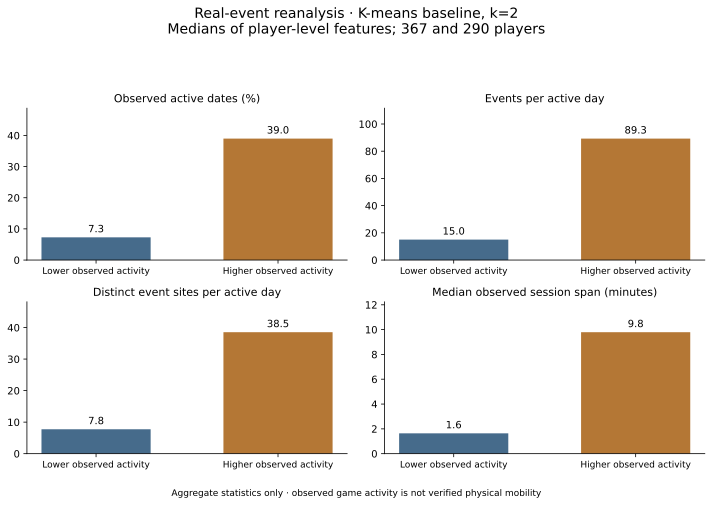

# Conclusions — real-event reanalysis

## What the evidence supports

The baseline partition mainly separates **lower and higher observed activity**. A three-cluster alternative additionally distinguishes frequently observed players from players observed on relatively few dates but with many events on those dates. These are descriptions of this collected sample, not verified or permanent player types.

K-means partitions are reproducible under player subsampling, but less consistent between the two time windows. This limits how strongly we can describe the groups as stable behavioural categories. The project demonstrates a reproducible comparison and its limitations, rather than a discovery of an objectively correct number of clusters.

## Study scope and provenance

The local reanalysis covers **22 January–3 March 2025 inclusive (UTC)**. The source contains **679,943 events**; **752 incomplete rows** are excluded from analysis while retained in the private derivative. There are **679,191 complete observations**, and **657 players** meet the minimum of five observations over the full study window.

This report is a new analysis of the original ARTISHOW data, conducted locally on pseudonymised records. It is not a reproduction of every original notebook conclusion. The original four-student project at Télécom Paris was conducted for Julien Morel. The new implementation and extensions are documented separately from the team's original contributions.

The real-event analysis uses seven activity/site-diversity features. **No physical path or travel-speed feature is used:** the data contain multiple sites for some player/timestamp groups, and an event site is not necessarily a player's physical position.

## Interpretable baseline: K-means, k=2

This is the first configured K-means candidate, used as an interpretable baseline. It has silhouette **0.295**, which indicates only partial separation under this representation, not a definitive typology.

Each table entry is a **median of player-level features**, not a pooled-event statistic. Active-date percentages refer to the full 41-date study window. Session span is observed first-to-last-event duration within a session, not continuously measured play time.

| Descriptive profile | Players | Observed active dates | Events / active day | Sites / active day | Session span (min) |
| --- | --- | --- | --- | --- | --- |
| Lower observed activity | 367 (55.9%) | 7.3% | 15.0 | 7.8 | 1.6 |
| Higher observed activity | 290 (44.1%) | 39.0% | 89.3 | 38.5 | 9.8 |

The higher-activity partition is observed on more dates, with more events and sites per active day and longer observed sessions. These differences should not be interpreted as personal motivation, employment patterns, home locations or true distance travelled.



## What changes with three clusters?

| Descriptive profile | Players | Observed active dates | Events / active day |
| --- | --- | --- | --- |
| Sparsely observed, lower-intensity activity | 325 (49.5%) | 7.3% | 13.0 |
| Frequently observed activity | 160 (24.4%) | 75.6% | 76.5 |
| Sparsely observed, higher-intensity activity | 172 (26.2%) | 7.3% | 83.5 |

The additional split suggests that **frequency of observation and intensity on an active date are distinct aspects of the data**. It does not establish that three is the true number of player types. Percentages are rounded, so totals may differ slightly from 100%.

## Model comparison and stability

The study compares K-means and Gaussian mixtures for k=2..5 and DBSCAN for eps=0.8/1.2/1.8/2.4, using the same transformed feature space. Stability uses **ten 80% player subsamples**, refitting scaling and clustering for each candidate. Temporal comparisons independently refit each model on the two halves of the study period and use **331 common eligible players**.

| Model | Clusters, excluding noise | Assigned coverage | Silhouette | Mean subsample ARI, jointly assigned | Temporal ARI, jointly assigned |
| --- | --- | --- | --- | --- | --- |
| kmeans_k2 | 2 | 100.0% | 0.295 | 0.947 | 0.374 |
| kmeans_k3 | 3 | 100.0% | 0.273 | 0.952 | 0.305 |
| kmeans_k4 | 4 | 100.0% | 0.242 | 0.873 | 0.296 |
| kmeans_k5 | 5 | 100.0% | 0.250 | 0.895 | 0.317 |
| gmm_k4 | 4 | 100.0% | 0.113 | 0.762 | 0.107 |
| dbscan_eps0.8 | 13 | 53.7% | 0.070 | 0.897 | 0.259 |
| dbscan_eps1.2 | 1 | 91.2% | undefined | undefined | undefined |
| dbscan_eps1.8 | 1 | 98.0% | undefined | undefined | undefined |
| dbscan_eps2.4 | 1 | 99.7% | undefined | undefined | undefined |

For K-means k=2, mean subsample ARI is **0.947**, while temporal ARI is **0.374**. For k=3, the corresponding values are **0.952** and **0.305**. Thus, partitions are relatively insensitive to which players are included in the same period, but less consistent when the observation period changes. Actual activity changes, observation coverage, eligibility selection and estimation variability may all contribute; this analysis does not distinguish their causes.

At eps=0.8, DBSCAN assigns only **53.7%** of players and produces thirteen groups. Its temporal jointly assigned ARI concerns only **8.8% of the common-player sample**; the apparently stronger assigned-only resampling score also has limited coverage. At larger radii, DBSCAN mostly merges assigned players into one group. Assigned-only ARI is therefore undefined, not evidence for a successful multi-group segmentation. Full noise-inclusive ARI and joint coverage are available in the aggregate JSON.

Among GMM candidates, BIC favours four components while AIC favours five. Their silhouette and temporal results do not establish clearer, more persistent behavioural types. Information criteria, separation and temporal consistency answer different questions; they need not agree.

## Sensitivity to modelling choices

Relative to K-means k=2 with 30-minute sessions and standard scaling:

- A 15-minute threshold gives partition ARI **0.905**; 60 minutes gives **0.876**.
- Robust scaling at 30 minutes gives ARI **0.865**.
- Across the six predefined threshold/scaling combinations, ARI ranges from **0.831 to 1.000**, including the identical reference case.

The broad activity split persists under these perturbations, while assignments still change. All 72 candidate sensitivity comparisons are included in the aggregate metrics. These are descriptive experiments, not a held-out predictive benchmark.

## Limits and next steps

- The sample is produced by a collection process; coverage and downtime have not been independently established. Few observed active dates do not prove genuine inactivity.
- Players with fewer than five complete observations are excluded, and temporal analysis further conditions on activity in both windows. Conclusions do not generalise to all Ingress players.
- The features include several measures of activity volume; this representation can emphasise an intensity continuum. Feature-ablation studies and observation-coverage models would help test that interpretation.
- Scaling and session thresholds affect assignments. Multiple candidate comparisons do not establish statistical significance or a uniquely correct clustering.
- No causal interpretation, sensitive personal inference, financial performance or predictive accuracy is claimed.
- The public report contains counts, medians and model-level diagnostics only. No group membership list, individual feature row, precise event location, individual timestamp, key or database is published. Minimum group size for exported profile tables is ten; that is an export rule, not a formal anonymity guarantee.

## Reproduction

The public synthetic demonstration is fully runnable without the private database. Reproducing these empirical figures requires the same locally held source data and environment:

```bash
python scripts/analyse_private.py \
  --database ../.scrapingress-private/events-pseudonymised.db \
  --output ../.scrapingress-private/publication-analysis \
  --repetitions 10 --sensitivity
python scripts/build_aggregate_report.py \
  --analysis ../.scrapingress-private/publication-analysis \
  --output reports/aggregate_metrics.json
python scripts/plot_aggregate_profiles.py \
  --summary reports/aggregate_metrics.json \
  --output reports/cluster_profiles.svg
```

[Aggregate numbers, grid, environment and diagnostics](aggregate_metrics.json). Empirical results cannot be independently reproduced from the public source alone because the real database is deliberately excluded; synthetic results must not be substituted for them.
